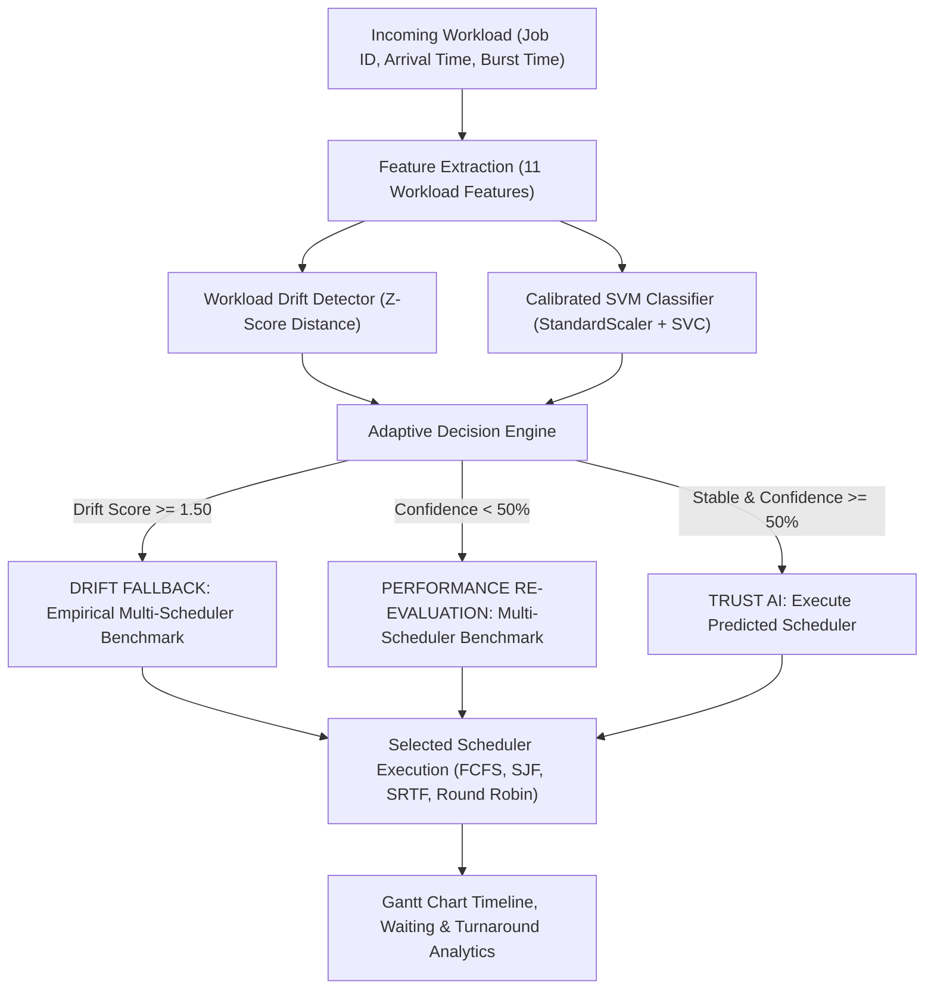

# AI-Based Adaptive CPU Scheduler

> **Workload-Aware CPU Scheduling Prototype with Machine Learning, Distribution Drift Detection, and Adaptive Performance Fallback**  
> **Authors:** Sayan Giri & Ansuman Singh &bull; **Academic Year:** 2026 &bull; **Institution:** Vellore Institute of Technology (VIT)

---

## 1. Project Overview & Architecture

Modern operating system workloads vary drastically in character—from bursty, interactive background services to long batch-processing jobs. Traditional CPU scheduling algorithms (FCFS, SJF, SRTF, Round Robin) make fixed scheduling assumptions that may result in suboptimal waiting and turnaround times when workload patterns shift.

This project implements an **Adaptive AI-Based CPU Scheduling System**:
1. **Workload Profiler**: Extracts 11 continuous statistical features characterizing job burst times, arrival rates, arrival gaps, and arrival-burst correlation.
2. **Workload Drift Detector**: Evaluates standardized z-score distances against the baseline training distribution to detect out-of-distribution or anomalous workload conditions ($Z$-score metric, threshold = $1.50$).
3. **Machine Learning Classifier (SVM)**: Predicts the optimal scheduling policy with calibrated class probabilities using a scikit-learn pipeline (`StandardScaler` + `SVC(probability=True)`).
4. **Adaptive Decision Engine**: Employs a three-tier decision hierarchy:
   - **TRUST AI**: Workload is stable ($\text{Drift Score} < 1.5$) and prediction confidence $\ge 50\%$.
   - **PERFORMANCE RE-EVALUATION**: Workload is stable, but prediction confidence $< 50\%$.
   - **DRIFT FALLBACK**: Workload distribution drift is detected ($\text{Drift Score} \ge 1.5$), triggering simulated comparative evaluation to select the best scheduling policy.
5. **Discrete-Event Simulation Engine**: High-fidelity simulators for FCFS, SJF, SRTF (event-driven preemption), and Round Robin ($q=4$) with accurate tracking of arrival, response, waiting, and turnaround times.
6. **Pure Black Workstation Console**: A Streamlit dashboard engineered with a professional graphite workstation layout, live host telemetry via `psutil`, and interactive timeline visualizations.

### System Architecture Flowchart



```
+-------------------------------------------------------------+
|                     Incoming Workload                       |
|       (Job IDs, Arrival Times, Burst Durations)             |
+-------------------------------------------------------------+
                               |
                               v
+-------------------------------------------------------------+
|             Feature Extraction (11 Features)                |
|  num_processes, avg/std burst, burst_range, avg/std arrival,|
|      avg/std arrival gaps, arrival_burst_correlation        |
+-------------------------------------------------------------+
            /                                     \
           v                                       v
+------------------------+             +----------------------+
|  Workload Drift Engine |             |    SVM Classifier    |
| (Z-Score Mahalanobis)  |             | (Calibrated Probas)  |
+------------------------+             +----------------------+
           \                                       /
            v                                     v
+-------------------------------------------------------------+
|                  Adaptive Decision Engine                   |
|   - Drift Detected?        -> Trigger DRIFT FALLBACK        |
|   - Low Confidence (<0.5)? -> Trigger RE-EVALUATE           |
|   - High Confidence?       -> TRUST AI                      |
+-------------------------------------------------------------+
                               |
                               v
+-------------------------------------------------------------+
|                  Selected Scheduler Execution               |
|            [ FCFS  |  SJF  |  SRTF  |  Round Robin ]        |
|            Execution Timeline (Gantt) & Analytics           |
+-------------------------------------------------------------+
```

---

## 2. Model Comparison Benchmark & Methodology

In accordance with model selection criteria, five distinct machine learning algorithms were trained and benchmarked on `model/training_data_diverse.csv` (400 samples) using identical stratified 80/20 train/test splits (`random_state=42`) and 5-fold stratified cross-validation on the training set.

### Feature Pipeline & Data Leakage Prevention
- **Features Used (11)**: `num_processes`, `avg_burst`, `std_burst`, `min_burst`, `max_burst`, `burst_range`, `avg_arrival`, `std_arrival`, `avg_arrival_gap`, `std_arrival_gap`, `arrival_burst_corr`.
- **Target Label**: `best_scheduler` (`SRTF`, `FCFS`, `SJF`).
- **Data Leakage Safeguard**: Preprocessing scalers (`StandardScaler`) were embedded into scikit-learn `Pipeline` objects and fit strictly on training folds. Scheduler performance outcome columns (`fcfs_waiting`, `srtf_score`, etc.) were completely excluded from model inputs.

### Empirical Results Table

| Model | Test Accuracy | Test Macro F1 | Balanced Accuracy | 5-Fold CV Macro F1 Mean | 5-Fold CV Macro F1 Std |
| :--- | :---: | :---: | :---: | :---: | :---: |
| **Decision Tree** | 85.00% | 0.7177 | 0.7177 | 0.6795 | &plusmn; 0.0385 |
| **Random Forest** | 80.00% | 0.6889 | 0.6962 | 0.7044 | &plusmn; 0.0543 |
| **K-Nearest Neighbors (KNN)** | 87.50% | 0.6962 | 0.6922 | 0.6686 | &plusmn; 0.0462 |
| **Support Vector Machine (SVM)\*** | 65.00% | 0.6825 | **0.8132** | **0.7069** | **&plusmn; 0.0371** |
| **Gradient Boosting** | 87.50% | 0.7355 | 0.7285 | 0.6648 | &plusmn; 0.0310 |

\* *Selected Model: Saved to `model/best_model.pkl`.*

### Model Selection Rationale
- **Primary Selection Criterion**: **5-Fold Cross-Validation Macro F1** on the training folds. SVM achieved the highest score (**0.7069 &plusmn; 0.0371**), followed by Random Forest (0.7044).
- **Holdout Analysis**: While Gradient Boosting obtained a higher test Macro F1 (0.7355) and KNN achieved higher raw test accuracy (87.50%) on this specific random split, their cross-validation Macro F1 scores (0.6648 and 0.6686) indicated higher fold-to-fold variance and poorer generalization across all splits.
- **Balanced Accuracy**: SVM achieved the highest Balanced Accuracy on the holdout test set (**81.32%**), reflecting its ability to balance class boundary margins under heavy class imbalance.

### SVM Test Set Confusion Matrix

```
                 Predicted
              FCFS   SJF   SRTF
Actual FCFS    10     0      0
Actual SJF      0     7      1
Actual SRTF     0    27     35
```

### Dataset Characteristics & Label Distribution
1. **Class Distribution**: In `training_data_diverse.csv` (400 samples):
   - **SRTF**: 308 (77.0%)
   - **FCFS**: 50 (12.5%)
   - **SJF**: 42 (10.5%)
2. **Theoretical Justification**: In operating systems scheduling theory, Preemptive Shortest Remaining Time First (SRTF) mathematically minimizes average waiting time across the vast majority of CPU workloads where preemption overhead is negligible. The model frequently recommending SRTF reflects this ground-truth reality.
3. **SJF vs. SRTF Boundary Overlap**: In samples where arrival times cluster closely, non-preemptive SJF and preemptive SRTF produce identical or near-identical waiting times.

---

## 3. Scheduler Algorithm Correctness & Verification

The core algorithms in `scheduler/schedulers.py` were rigorously audited, corrected, and verified:
1. **Event-Driven Preemption in SRTF**: Replaced fixed 1.0-unit clock stepping with dynamic event advancement (`step = min(remaining, next_arrival - time)`). This ensures exact mathematical preemption when processes arrive at fractional timestamps (e.g. 1.5 ms) and calculates response times with zero delay.
2. **CPU Idle Period Fast-Forwarding**: In FCFS, SJF, and SRTF, idle intervals fast-forward directly to the next arrival rather than iterating pointlessly through idle clock ticks.
3. **Zero-Burst Handling**: Processes with `burst == 0` complete immediately at arrival time with 0 waiting and 0 response time without inducing infinite loops.
4. **Unique Tracking for Duplicate Process IDs**: Schedulers index jobs by unique sequence identifiers (`_idx`) rather than raw PID strings, preventing state corruption when duplicate PIDs are submitted.
5. **Response Time Calculation**: In all algorithms (especially Round Robin and SRTF), **response time** is computed strictly as $\text{first\_start\_time} - \text{arrival\_time}$.
6. **Consistent Round Robin Quantum**: Standardized default `quantum=4` across the backend, simulation models, and dashboard.

---

## 4. Setup & Installation Instructions

### Prerequisites
- Python 3.10 to 3.13
- Windows, macOS, or Linux

### Step 1: Virtual Environment Setup
Open PowerShell or your terminal in the repository:

```powershell
# Navigate to the project directory
cd "c:\Users\user\Downloads\AI adaptive CPU Scheduler"

# Activate existing virtual environment
.\.venv\Scripts\Activate.ps1
```

*(If activating on macOS/Linux: `source .venv/bin/activate`)*

### Step 2: Install Dependencies
```powershell
pip install -r requirements.txt
```

---

## 5. Execution Commands for Evaluation & Demonstration

### Command 1: Run the Unified Automated Test Suite (26 Tests)
Executes all 26 tests across all 6 test modules (scheduling algorithms, deterministic ground-truth verification, decision engine paths, drift detection, prediction pipeline, and Streamlit state toggling):

```powershell
cd Adaptive-ai-cpu-scheduler
python -m unittest discover -s tests -v
```
*Expected Output: `Ran 26 tests in ~34s: OK`*

### Command 2: Run Deterministic Scheduler Metric Tests
```powershell
python -m unittest tests/test_deterministic.py -v
```

### Command 3: Test Decision Engine Logic & Threshold Boundary
```powershell
python -m unittest tests/test_decision_engine.py -v
```

### Command 4: Test Bidirectional Dashboard State & Workload Toggling
```powershell
python -m unittest tests/test_app_test.py -v
```

### Command 5: Launch the Streamlit Dashboard
```powershell
streamlit run app.py
```
*Access the console in your browser at: `http://localhost:8501`*

---

## 6. Demonstration Walkthrough Guide for Faculty Review

1. **Dashboard Overview**:
   - Point out the pure black/charcoal engineering workstation visual identity.
   - Show the top host system telemetry (`psutil` CPU %, Memory %, active process count) and explain that this measures genuine host telemetry, distinguishing it from the simulated workload engine.
2. **Normal Workload Demonstration**:
   - Note the green `● NORMAL PROFILE` badge on the Process Workload container.
   - Adjust the **Processes** slider (e.g., from 5 to 8).
   - In **AI Decision & Explainability**, demonstrate:
     - Recommended Scheduler: `SRTF`
     - Confidence: `~80.8%`
     - Drift Status: `No Drift` | `Score: 1.263 (Lim: 1.50)`
     - Decision: `TRUST AI`
     - Probability bar chart showing calibrated multi-class distribution.
   - In **Scheduler Comparison**, show that SRTF achieves the lowest average waiting time, verifying that the AI recommendation aligns with ground truth.
   - In **Execution Timeline**, inspect the Gantt chart illustrating the execution schedule.
3. **Drift Detection & Adaptive Fallback Demonstration**:
   - Click the **Drift Test** radio button.
   - Notice that within the exact same frame:
     - Profile badge switches to red `▲ DRIFT TEST ACTIVE`.
     - Drift Status switches to red `Drift` with `Score: 5.298 (Lim: 1.50)`.
     - Decision engine automatically activates `FALLBACK` with rationale: *"Workload drift detected beyond safety threshold (1.5). AI recommendation is not trusted; falling back to empirical performance evaluation."*
     - Selection method displays `DRIFT FALLBACK`, selecting `FCFS`.
   - Click back to **Normal Workload** to demonstrate seamless bidirectional state restoration without lag or stale badges.
4. **Specialized Views**:
   - Click **Workload Analysis** in the sidebar to inspect statistical features and drift evaluation against baseline training distributions.
   - Click **Scheduler Comparison** to show side-by-side comparative bar charts across all policies.
   - Click **Execution Timeline** to inspect individual algorithm Gantt charts.
   - Click **System Monitor** to show detailed host hardware metrics.

---

## 7. Project File Structure

```
Adaptive-ai-cpu-scheduler/
├── app.py                          # Streamlit engineering workstation dashboard
├── process_data.csv                # Benchmark process dataset (500 jobs)
├── requirements.txt                # Project dependencies
├── drift/
│   ├── workload_detector.py        # Z-score drift detector against training distributions
│   └── test_drift.py               # Standalone drift verification script
├── model/
│   ├── best_model.pkl              # Trained SVM pipeline (StandardScaler + SVC)
│   ├── random_forest_scheduler.pkl  # Preserved baseline Random Forest artifact
│   ├── model_comparison_results.csv# 5-model benchmark comparison metrics
│   ├── compare_models.py           # Benchmark script for the 5 ML models
│   ├── predict.py                  # Feature extraction and model inference logic
│   ├── decision_engine.py          # Three-tier decision engine (Trust AI, Re-evaluate, Fallback)
│   ├── adaptive_scheduler.py       # Orchestration engine combining prediction & simulation
│   ├── workload_features.py        # 11-feature extraction utility
│   ├── training_data_diverse.csv   # 400-sample diverse workload training dataset
│   └── test_adaptive_drift.py      # Automated integration test for drift fallback
├── monitoring/
│   └── system_monitor.py           # Host system metrics capture via psutil
├── scheduler/
│   └── schedulers.py               # Schedulers (FCFS, SJF, SRTF, Round Robin)
└── tests/
    ├── test_schedulers.py          # Core 9-test scheduling unit test suite
    ├── test_deterministic.py       # 8 ground-truth deterministic scheduling tests
    ├── test_decision_engine.py     # 4 decision engine path & threshold boundary tests
    ├── test_diverse_predictions.py # 2 ML pipeline validity & inference tests
    ├── test_toggle.py              # 2 normal vs drift workload drift tests
    └── test_app_test.py            # Automated Streamlit bidirectional state test
```

---

## 8. Simulation Scope & Engineering Disclaimer

> [!NOTE]
> This system is designed as an analytical simulator and workload-aware scheduling decision engine. It operates on discrete-event simulation algorithms to model CPU scheduling dynamics and evaluate machine learning adaptation under distribution shift. It does not replace or modify the native Windows NT / Linux kernel dispatcher.

---

## 9. Team Contributions

- **Ansuman Singh**: Machine learning pipeline architecture, workload dataset generation (`training_data_diverse.csv`), model comparison framework (`compare_models.py`), SVM probability calibration, workload distribution drift detection logic, and decision engine integration.
- **Sayan Giri**: Discrete-event CPU scheduling algorithms (`fcfs`, `sjf`, `srtf`, `round_robin_metrics`), event-driven preemption handling, simulation trace and Gantt timeline generation, performance metric aggregation (`summarize`), and host hardware telemetry integration (`psutil`).
